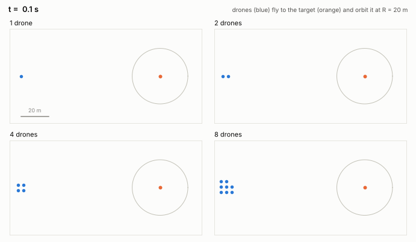

# Drone encirclement as particles (prototype)

N drones (1 to 8) take off from a launch area 100 m away, fly to a target and
orbit it at a standoff radius R = 20 m, evenly spaced. The drones are modelled
as **particles**: point masses whose velocity relaxes to the commanded velocity
with the response time of their velocity controller (τ = 0.5 s), plus random
gusts. The dynamics are integrated with the Langevin integrator of
[ParticleGym](https://github.com/ZhaojieC/particlegym), where the command is
the drift velocity.

The prototype has two parts:

1. **A physics-based controller** (no learning) that solves the nominal task
   for any number of drones. It is a baseline, and a prior for learning.
2. **A JAX reinforcement-learning environment** in which policies for 1 to 8
   drones train together, with thousands of environments in parallel.



## The controller

Each drone receives the commanded velocity

```
u_i = v_i + τ a_i + k_r (R − ρ_i) e_r + u_rep,i + v_target,     v_i = s_i f(r_i)
```

- `f` is the unit **Lyapunov guidance vector field** for standoff tracking
  (Lawrence, Frew & Pisano 2008; Frew, Lawrence & Morris 2008). It converges to
  the circle of radius R from anywhere and circulates counterclockwise.
- `s_i` is the drone's speed, raised or lowered near the circle by **phase
  balancing**: a drone with a larger gap ahead than behind speeds up. This is
  diffusion of the angular gaps around the ring, so the drones spread evenly
  without knowing how many there are.
- `τ a_i`, with `a_i = (v_i · ∇) v_i` computed by automatic differentiation,
  **compensates the lag** of the velocity controller. Without it the orbit
  widens by about ωτR (2.5 m here).
- `k_r (R − ρ_i) e_r` stiffens the orbit against gusts near the circle.
- `u_rep,i` is a short-range repulsion below 3 m; `v_target` is the target velocity.

Commands are saturated at 8 m/s; the nominal orbit speed is 5 m/s.

### Results

`python scripts/run_controller.py`. A run counts as converged when every drone
is within 10 % of R and every angular gap within 10 % of 2π/N, for at least 95 %
of the remaining time. Radial RMS and spacing (coefficient of variation of the
angular gaps) are averaged over the last 24 s of a 120 s run; minimum
separation and maximum speed are taken over the whole run.

| Case | Convergence (s) | Radial RMS (m) | Spacing CV | Min. separation (m) | Max. speed (m/s) |
|---|---|---|---|---|---|
| 1 drone | 15.8 | 0.09 | n/a | n/a | 6.1 |
| 2 drones | 23.0 | 0.09 | 0.000 | 3.8 | 8.0 |
| 3 drones | 27.5 | 0.09 | 0.000 | 2.9 | 8.0 |
| 4 drones | 30.3 | 0.09 | 0.000 | 2.9 | 8.0 |
| 5 drones | 31.5 | 0.09 | 0.000 | 2.9 | 8.0 |
| 6 drones | 34.7 | 0.09 | 0.000 | 2.7 | 8.0 |
| 7 drones | 37.7 | 0.09 | 0.000 | 2.7 | 8.0 |
| 8 drones | 41.8 | 0.09 | 0.000 | 2.2 | 8.0 |
| 8 drones, gusts 0.3 m/s | 40.9 | 0.28 | 0.024 | 2.1 | 8.4 |
| 8 drones, target moving at 2 m/s | 45.3 | 0.09 | 0.000 | 2.2 | 8.0 |
| 8 drones, gusts and moving target | 46.3 | 0.29 | 0.025 | 2.4 | 8.5 |

Convergence includes the ~100 m flight from the launch area. Max. speed can
exceed the 8 m/s command limit slightly when gusts are on.

## The reinforcement-learning environment

```python
from encircle import Encircle

env = Encircle(n_max=8, n_min=1)  # each episode draws 1-8 active drones
params = env.default_params
obs, state = env.reset(key, params)  # obs: (8, 20)
obs, state, reward, done, info = env.step(key, state, action, params)  # action: (8, 2)
```

- **Functional and batchable**: `reset` and `step` are pure; compile with
  `jax.jit`, batch with `jax.vmap`. `params` (radius, speed, gusts, target speed,
  reward weights) is a pytree, so it can be randomised per environment.
- **1 to 8 drones in one policy**: inactive drones are masked out, and the
  observation (own state relative to the target plus the 3 nearest neighbours)
  does not depend on the number of drones, so one shared policy covers all N.
- **Residual actions** (default): the action is added to the controller command
  with phase balancing and repulsion switched off. A zero action already flies
  every drone onto the orbit; the policy only has to learn the coordination.
  `residual=False` makes the action the full velocity command.
- **Reward** per drone (0 is perfect): orbit-radius error, orbit-speed error,
  spacing error, and a penalty for coming closer than 3 m.

Throughput on a 4-core CPU (`python scripts/bench_env.py`; one step is 0.1 s
for up to 8 drones):

| Parallel environments | Environment steps per second |
|---|---|
| 1 | 39,435 |
| 64 | 129,518 |
| 512 | 142,444 |
| 4096 | 323,136 |

At 300,000 steps per second, 10 million environment steps take about half a
minute on this CPU. GPU throughput has not been measured.

## Running

```bash
pip install -e ".[test]"           # installs ParticleGym from GitHub as well
python scripts/run_controller.py   # metrics table
python scripts/animate.py          # encircle.gif
python scripts/bench_env.py        # environment throughput
pytest                             # tests
```

## Limitations of the prototype

- 2D: the drones fly at a fixed altitude.
- Point masses with a first-order velocity loop; no attitude dynamics, thrust
  limits or latency. The model fits a policy that sends velocity setpoints to a
  flight controller (for example PX4) that tracks them.
- Perfect knowledge of the target and of the other drones; no obstacles and no
  communication limits.
- No policy has been trained yet.

## Next steps

1. Train a shared residual policy (PPO, all in JAX) on 1 to 8 drones and compare
   it with the controller on the metrics above.
2. Randomise gusts, response time, latency and target motion during training.
3. Check the policy in a higher-fidelity simulator through velocity setpoints
   before flight tests.

## References

- D. A. Lawrence, E. W. Frew and W. J. Pisano, Lyapunov vector fields for
  autonomous unmanned aircraft flight control, *J. Guidance, Control, and
  Dynamics* 31(5), 1220–1229 (2008).
- E. W. Frew, D. A. Lawrence and S. Morris, Coordinated standoff tracking of
  moving targets using Lyapunov guidance vector fields, *J. Guidance, Control,
  and Dynamics* 31(2), 290–306 (2008).
- B. Leimkuhler and C. Matthews, Rational construction of stochastic numerical
  methods for molecular sampling, *Appl. Math. Res. Express* 2013, 34–56 (2013).
