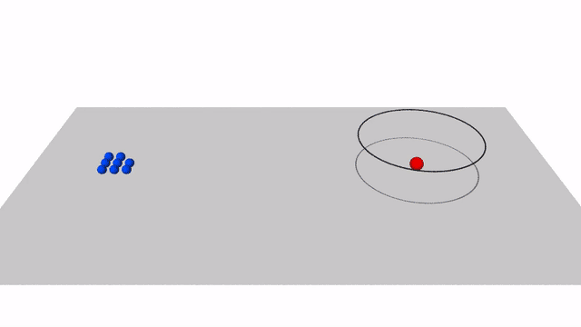

# Drone encirclement as particles (prototype)

N drones (1 to 8) take off from a launch area 100 m away, fly to a target and
orbit it at a standoff radius R = 20 m, evenly spaced. The task is available
in 2D (all drones at one altitude) and in [3D](#three-dimensions) (the drones
climb to an orbit above the target). The drones are modelled
as **particles**: point masses whose velocity relaxes to the commanded velocity
with the response time of their velocity controller (τ = 0.5 s), plus random
gusts. The dynamics are integrated with the Langevin integrator of
[ParticleGym](https://github.com/ZhaojieC/particlegym), where the command is
the drift velocity.

The prototype has two parts:

1. **A physics-based controller** (no learning) that solves the nominal task
   for any number of drones. It is a baseline, and a prior for learning.
2. **A JAX reinforcement-learning environment** in which policies for 1 to 8
   drones train together, with thousands of environments in parallel.


## The controller

Each drone receives the commanded velocity

```
u_i = v_i + τ a_i + k_r (R − ρ_i) e_r + u_rep,i + v_target,     v_i = s_i f(r_i)
```

- `f` is the unit **Lyapunov guidance vector field** for standoff tracking
  (Lawrence, Frew & Pisano 2008; Frew, Lawrence & Morris 2008). It converges to
  the circle of radius R from anywhere and circulates counterclockwise.
- `s_i` is the drone's speed, raised or lowered near the circle by **phase
  balancing**: a drone with a larger gap ahead than behind speeds up. This is
  diffusion of the angular gaps around the ring, so the drones spread evenly
  without knowing how many there are.
- `τ a_i`, with `a_i = (v_i · ∇) v_i` computed by automatic differentiation,
  **compensates the lag** of the velocity controller. Without it the orbit
  widens by about ωτR (2.5 m here).
- `k_r (R − ρ_i) e_r` stiffens the orbit against gusts near the circle.
- `u_rep,i` is a short-range repulsion below 3 m; `v_target` is the target velocity.

Commands are saturated at 8 m/s; the nominal orbit speed is 5 m/s.

### Results

`python scripts/run_controller.py`. A run counts as converged when every drone
is within 10 % of R and every angular gap within 10 % of 2π/N, for at least 95 %
of the remaining time. Radial RMS and spacing (coefficient of variation of the
angular gaps) are averaged over the last 24 s of a 120 s run; minimum
separation and maximum speed are taken over the whole run.

| Case | Convergence (s) | Radial RMS (m) | Spacing CV | Min. separation (m) | Max. speed (m/s) |
|---|---|---|---|---|---|
| 1 drone | 15.8 | 0.09 | n/a | n/a | 6.1 |
| 2 drones | 23.0 | 0.09 | 0.000 | 3.8 | 8.0 |
| 3 drones | 27.5 | 0.09 | 0.000 | 2.9 | 8.0 |
| 4 drones | 30.3 | 0.09 | 0.000 | 2.9 | 8.0 |
| 5 drones | 31.5 | 0.09 | 0.000 | 2.9 | 8.0 |
| 6 drones | 34.7 | 0.09 | 0.000 | 2.7 | 8.0 |
| 7 drones | 37.7 | 0.09 | 0.000 | 2.7 | 8.0 |
| 8 drones | 41.8 | 0.09 | 0.000 | 2.2 | 8.0 |
| 8 drones, gusts 0.3 m/s | 40.9 | 0.28 | 0.024 | 2.1 | 8.4 |
| 8 drones, target moving at 2 m/s | 45.3 | 0.09 | 0.000 | 2.2 | 8.0 |
| 8 drones, gusts and moving target | 46.3 | 0.29 | 0.025 | 2.4 | 8.5 |

Convergence includes the ~100 m flight from the launch area. Max. speed can
exceed the 8 m/s command limit slightly when gusts are on.

## The reinforcement-learning environment

```python
from encircle import Encircle

env = Encircle(n_max=8, n_min=1)  # each episode draws 1-8 active drones
params = env.default_params
obs, state = env.reset(key, params)  # obs: (8, 20)
obs, state, reward, done, info = env.step(key, state, action, params)  # action: (8, 2)
```

- **Functional and batchable**: `reset` and `step` are pure; compile with
  `jax.jit`, batch with `jax.vmap`. `params` (radius, speed, gusts, target speed,
  reward weights) is a pytree, so it can be randomised per environment.
- **1 to 8 drones in one policy**: inactive drones are masked out, and the
  observation (own state relative to the target plus the 3 nearest neighbours)
  does not depend on the number of drones, so one shared policy covers all N.
- **Residual actions** (default): the action is added to the controller command
  with phase balancing and repulsion switched off. A zero action already flies
  every drone onto the orbit; the policy only has to learn the coordination.
  `residual=False` makes the action the full velocity command.
- **Reward** per drone (0 is perfect): orbit-radius error, orbit-speed error,
  spacing error, and a penalty for coming closer than 3 m.

Throughput on a 4-core CPU (`python scripts/bench_env.py`; one step is 0.1 s
for up to 8 drones):

| Parallel environments | Environment steps per second |
|---|---|
| 1 | 39,435 |
| 64 | 129,518 |
| 512 | 142,444 |
| 4096 | 323,136 |

At 300,000 steps per second, 10 million environment steps take about half a
minute on this CPU. Throughput on a larger CPU node and on a GPU is listed
[below](#throughput).

## Three dimensions

Pass `dim=3` to the scenario or to the environment. The same code runs both
cases, and the 2D results above are unchanged.



The drones take off at the altitude of the target and climb to the orbit: a
circle of radius R in the plane normal to `axis`, whose centre is `height`
(default 10 m) above the target along that axis. By default the axis is
vertical, so the orbit is a horizontal circle above the target; a tilted axis
gives a tilted orbit. The controller applies the 2D rule to the components of
the position in the orbit plane and adds a proportional approach to the plane:

```
v_i = s_i f(r_i in the plane) − clip(k_h ζ_i) n
```

where ζ is the height of the drone above the orbit plane, n the orbit axis and
k_h = 0.5 /s. Lag compensation, radial feedback, repulsion and the target
velocity act in 3D as in 2D. Horizontal and vertical speeds are limited
separately (8 m/s and 3 m/s by default), as for a multirotor. The limits, the
response time and the orbit are parameters to be set for the actual vehicle
and mission; the defaults are assumptions.

```python
from encircle import Encircle, EncircleController, EncircleParams, Scenario, evaluate, simulate

controller = EncircleController(height=10.0)  # horizontal orbit 10 m above the target
scenario = Scenario(dim=3, target_velocity=(2.0, 0.0, 1.0))  # target moves and climbs
metrics = evaluate(simulate(scenario, controller), controller.radius, height=controller.height)

env = Encircle(dim=3)  # obs: (8, 28), action: (8, 3)
params = EncircleParams(height=10.0, target_speed=2.0, target_climb=1.0)
```

In the environment the vertical component of an action is in units of
`max_vertical_speed`. Observations hold three components per vector, with the
drone's position relative to the centre of the orbit. The radial term of the
reward is the distance to the orbit, which includes the height error.

**Check against 2D.** With the orbit at the launch altitude (`height=0`), the
3D run reproduces the 2D run of 8 drones: positions agree within 1e-9 m over
120 s (`tests/test_controller_3d.py`).

### Results in 3D

`python scripts/run_controller.py --dim 3` (same criteria as in 2D; a converged
drone must also be within 10 % of R of the orbit plane). Max. speed is the
largest horizontal speed.

| Case | Convergence (s) | Radial RMS (m) | Height RMS (m) | Spacing CV | Min. separation (m) | Max. speed (m/s) | Max. vertical speed (m/s) |
|---|---|---|---|---|---|---|---|
| 1 drone | 15.8 | 0.09 | 0.00 | n/a | n/a | 6.1 | 2.9 |
| 2 drones | 23.0 | 0.09 | 0.00 | 0.000 | 3.8 | 8.0 | 2.9 |
| 3 drones | 27.5 | 0.09 | 0.00 | 0.000 | 2.9 | 8.0 | 2.9 |
| 4 drones | 30.3 | 0.09 | 0.00 | 0.000 | 2.9 | 8.0 | 2.9 |
| 5 drones | 31.5 | 0.09 | 0.00 | 0.000 | 2.9 | 8.0 | 2.9 |
| 6 drones | 34.7 | 0.09 | 0.00 | 0.000 | 2.7 | 8.0 | 2.9 |
| 7 drones | 37.7 | 0.09 | 0.00 | 0.000 | 2.7 | 8.0 | 2.9 |
| 8 drones | 41.8 | 0.09 | 0.00 | 0.000 | 2.2 | 8.0 | 2.9 |
| 8 drones, gusts 0.3 m/s | 41.0 | 0.26 | 0.31 | 0.027 | 2.1 | 8.6 | 3.6 |
| 8 drones, target moving at 2 m/s | 45.3 | 0.09 | 0.00 | 0.000 | 2.2 | 8.0 | 2.9 |
| 8 drones, gusts and moving target | 44.8 | 0.28 | 0.31 | 0.023 | 1.8 | 8.9 | 3.6 |
| 8 drones, target moving at 2 m/s and climbing at 1 m/s | 45.3 | 0.09 | 0.00 | 0.000 | 2.2 | 8.0 | 3.0 |
| 8 drones, gusts, moving and climbing target | 44.8 | 0.28 | 0.31 | 0.023 | 1.8 | 8.9 | 3.6 |
| 8 drones, orbit tilted by 30° | 42.3 | 0.09 | 0.00 | 0.000 | 2.2 | 8.0 | 3.0 |

Without gusts the convergence times are the same as in 2D: the 10 m climb at
3 m/s ends before the drones reach the target, and all drones climb together,
so the altitude does not help them to stay apart. With gusts the height error
is about as large as the radial error, and the speeds exceed the command
limits by up to 0.9 m/s.

### Throughput

Environment steps per second with JAX 0.11.2 (`python scripts/bench_env.py`).
The numbers are for the environment alone, with zero actions; a policy network
and its training are not included.

12 cores of an AMD EPYC 7662 (`bench_cpu_oscar.txt`):

| Parallel environments | 2D | 3D |
|---|---|---|
| 1 | 68,376 | 43,815 |
| 64 | 108,890 | 55,905 |
| 512 | 97,725 | 81,957 |
| 4,096 | 229,048 | 173,894 |

One NVIDIA L40S GPU (`bench_gpu_oscar.txt`):

| Parallel environments | 2D | 3D |
|---|---|---|
| 4,096 | 76,615,083 | 64,737,100 |
| 16,384 | 204,692,823 | 160,242,113 |
| 65,536 | 370,435,125 | 290,635,437 |
| 262,144 | 39,429,152 | 106,700,074 |

With 65,536 parallel environments the GPU is about 1,600 times (2D) and 1,700
times (3D) faster than the 12 CPU cores with 4,096. With 262,144 environments
the throughput on the GPU drops; a second run gave the same drop, and its
cause has not been investigated.

## Running

```bash
pip install -e ".[test]"                   # installs ParticleGym from GitHub as well
python scripts/run_controller.py           # metrics table (add --dim 3 for 3D)
python scripts/animate.py                  # encircle.gif (2D)
python scripts/bench_env.py                # environment throughput (add --dim 3 for 3D)
python scripts/export_scene.py --output scene   # 3D run as files for OVITO
python scripts/render_ovito.py scene       # frames of the 3D video; needs the ovito package
pytest                                     # tests
```

## Limitations of the prototype

- In 3D the orbit is a single circle; the drones do not yet use the altitude
  to stay apart, and there is no model of the downwash below a drone.
- No ground, terrain or obstacles: altitudes are relative to the target, and
  nothing stops a commanded descent.
- The same response time for horizontal and vertical motion.
- Point masses with a first-order velocity loop; no attitude dynamics, thrust
  limits or latency. The model fits a policy that sends velocity setpoints to a
  flight controller (for example PX4) that tracks them.
- Perfect knowledge of the target and of the other drones; no obstacles and no
  communication limits.
- No policy has been trained yet.

## Assumptions

The orbit, the speed limits and the response time are assumptions (R = 20 m,
10 m above the target, 8 m/s horizontal and 3 m/s vertical, τ = 0.5 s). They
are not the data of a particular vehicle or mission. To apply the prototype to
a real task, the following has to be specified:

1. The vehicle: its size, its speed and climb limits, and how fast it follows
   a velocity command.
2. What the policy outputs: velocity setpoints, as here, or accelerations,
   attitude and thrust, or waypoints.
3. What each drone can sense and what the drones can tell each other: the
   position of the target and of the other drones, with which noise, delay and
   range.
4. How the target moves: at rest, at constant velocity, or manoeuvring.
5. What counts as success: the orbit radius and height, the spacing tolerance,
   the minimum separation, the time limit.

## Next steps

1. Train a shared residual policy (PPO, all in JAX) on 1 to 8 drones and compare
   it with the controller on the metrics above.
2. Randomise gusts, response time, latency and target motion during training.
3. Check the policy in a higher-fidelity simulator through velocity setpoints
   before flight tests.

## References

- D. A. Lawrence, E. W. Frew and W. J. Pisano, Lyapunov vector fields for
  autonomous unmanned aircraft flight control, *J. Guidance, Control, and
  Dynamics* 31(5), 1220–1229 (2008).
- E. W. Frew, D. A. Lawrence and S. Morris, Coordinated standoff tracking of
  moving targets using Lyapunov guidance vector fields, *J. Guidance, Control,
  and Dynamics* 31(2), 290–306 (2008).
- B. Leimkuhler and C. Matthews, Rational construction of stochastic numerical
  methods for molecular sampling, *Appl. Math. Res. Express* 2013, 34–56 (2013).

## License

MIT; see [LICENSE](LICENSE).
